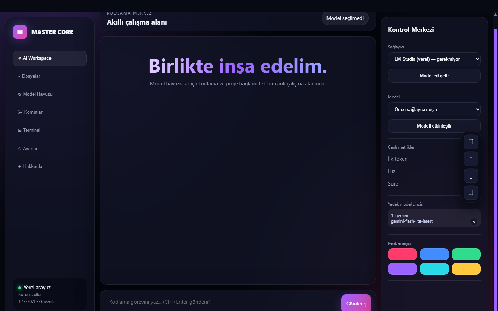
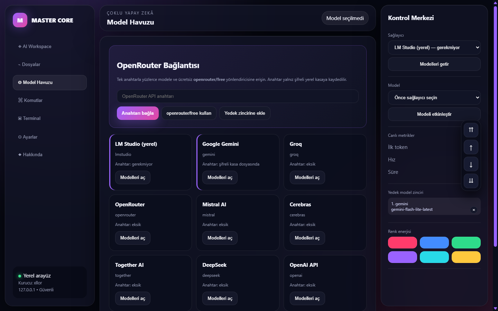
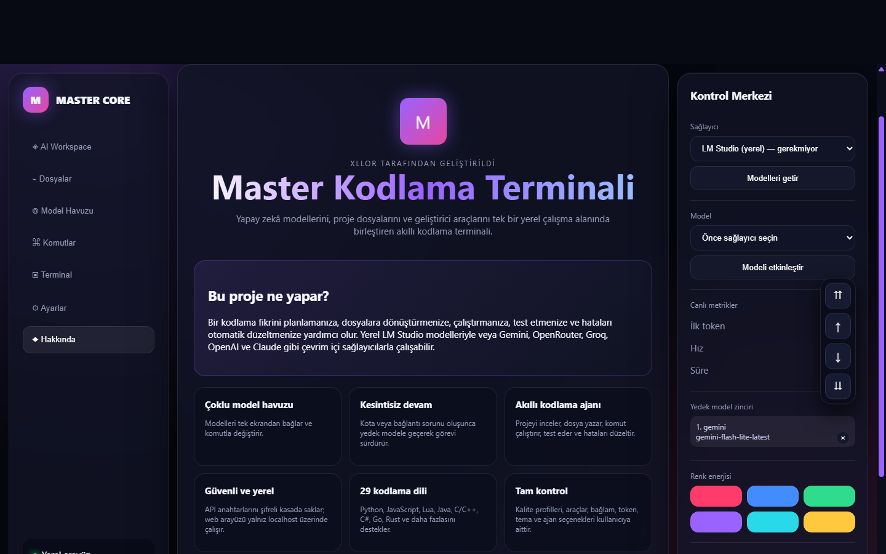

<div align="center">

# 🔥 MASTER KODLAMA TERMİNALİ

### Çoklu yapay zekâ destekli yeni nesil kodlama çalışma alanı


**Kurucu: `xllor`**

`Kod üret • Projeyi incele • Test et • Hataları düzelt • Model değiştir`

</div>

---

Master Kodlama Terminali; yapay zekâ modellerini, proje dosyalarını ve
geliştirici araçlarını tek bir yerel çalışma alanında birleştirir. Kod üretir,
projeyi inceler, dosya düzenler, test çalıştırır, hataları düzeltir ve kota
bittiğinde yapılandırılmış yedek modele geçerek göreve devam eder.

> [!CAUTION]
> **!! ÖNEMLİ SORUMLULUK AÇIKLAMASI !!**  
> Bu projeyle yapılan işlemlerden kullanıcı sorumludur. Proje kurucusu ve
> geliştiricileri, kullanıcıların yaptığı işlemlerden ve ortaya çıkabilecek
> sonuçlardan sorumluluk kabul etmez.

## ✨ Öne çıkan özellikler

| Özellik | Açıklama |
|---|---|
| 🤖 Çoklu model | Gemini, OpenRouter, Groq, OpenAI, Claude, LM Studio ve daha fazlası |
| 🔁 Akıllı yedekleme | Kota veya bağlantı sorunu olduğunda başka modele otomatik geçiş |
| 🧠 Kodlama ajanı | Planlar, dosya yazar, çalıştırır, test eder ve düzeltir |
| 🗺️ Proje zekâsı | Dosya haritasını çıkarır ve görevle ilgili bağlamı seçer |
| 🔐 Güvenli anahtarlar | API anahtarlarını Windows hesabına bağlı şifreli kasada saklar |
| 🌐 Web paneli | Model havuzu, dosyalar, terminal, ayarlar ve komut merkezi |
| 🎨 Kişiselleştirme | Animasyonlu açılış, renk temaları ve kalite profilleri |
| 💻 29 dil | Python, JavaScript, Lua, Java, C/C++, C#, Go, Rust ve daha fazlası |

## 🖼️ Arayüzden görüntüler

### Akıllı çalışma alanı

Model seçimi, canlı metrikler, renk temaları ve AI sohbet alanı tek ekranda.



### Model havuzu

Yerel ve çevrim içi sağlayıcıları görüntüleyin, OpenRouter bağlayın ve yedek
model zincirinizi yönetin.



### Proje tanıtımı ve özellikler

Terminalin yetenekleri, güvenlik yaklaşımı ve proje bilgileri.



## 🚀 Windows kurulumu

1. GitHub sayfasından projeyi ZIP olarak indirin ve klasöre çıkarın.
2. Bilgisayarda [Python 3.10 veya daha yeni bir sürüm](https://www.python.org/downloads/)
   bulunmalıdır. Python kurulurken **Add Python to PATH** seçeneğini işaretleyin.
3. `KURULUM.bat` dosyasına çift tıklayın. Gerekli kütüphaneler otomatik yüklenir
   ve kurulum doğrulanır.
4. Kurulum tamamlanınca `BASLAT.bat` dosyasına çift tıklayın.
5. Terminal açıldıktan sonra `/providers` ile sağlayıcıları görüntüleyin;
   istediğiniz API anahtarını Model Havuzu veya `/apikey set <sağlayıcı>` ile ekleyin.

Kurulum sırasında API anahtarı istenmez. Anahtarlar daha sonra kullanıcının kendi
bilgisayarındaki şifreli kasaya kaydedilir.

## 🛠️ Elle kurulum ve başlatma

```powershell
python -m pip install -r requirements.txt
python terminal_init.py
```

Açılış logosu renkli bir animasyonla çizilir. Tema ve animasyon tercihi kalıcıdır:

```text
/theme green
/theme blue
/theme purple
/theme random
/animation off
/animation on
```

Yerel web kontrol merkezini açmak ve kapatmak için:

```text
/werb on
/werb status
/werb off
```

`/web on` kısa adı da kullanılabilir. Arayüz yalnız `127.0.0.1` üzerinde açılır;
sağlayıcı/model seçimi, sohbet, dosya üretimi, performans metrikleri, yedek model
zinciri ve canlı tema değişimi sunar.

LM Studio'da modeli yükleyip yerel sunucuyu başlatın. Sunucu ve model
ayarlarını terminalde `/server`, `/models` ve `/model` ile değiştirebilirsiniz.
Bağlantı ve araç durumunu görmek için `/doctor` kullanın.

Terminal açılırken hiçbir sağlayıcıya bağlanmaz, LM Studio'yu kontrol etmez ve
önceki modeli otomatik etkinleştirmez. Her yeni oturumda modeli elle seçin:

```text
/use gemini <model-id>
```

LM Studio için seçim de manueldir:

```text
/server http://localhost:1234/v1
/models
/model qwen2.5-coder-7b-instruct-uncensored
```

## 🤖 Çoklu model sağlayıcısı

Terminal LM Studio, Gemini, Groq, OpenRouter, Mistral,
Cerebras, Together, DeepSeek, OpenAI ve Anthropic Claude bağlantılarını destekler.
Model adları zamanla değiştiği için aktif sağlayıcının güncel listesini `/models`
ile alın.

```text
/providers
/apikey set gemini
/provider gemini
/models
/use gemini <models-listesinde-görünen-model-id>
```

`/use` sağlayıcıyı ve modeli tek komutla seçer. API anahtarı komut satırında
görünmez ve `.terminal_config.json` içine yazılmaz; işletim sisteminin güvenli
kimlik kasasında tutulur. İsterseniz `GEMINI_API_KEY`, `GROQ_API_KEY`,
`OPENROUTER_API_KEY`, `OPENAI_API_KEY`, `ANTHROPIC_API_KEY` gibi ortam
değişkenlerini de kullanabilirsiniz. Anahtar durumunu `/apikey status`, silmeyi
`/apikey delete <sağlayıcı>` ile yapabilirsiniz.

Listede olmayan OpenAI uyumlu bir servis için `/apikey set custom`, ardından
`/provider custom https://servis-adresi/v1` ve `/model <model-id>` kullanın.

## 🔁 Kota bitince otomatik model geçişi

Anahtarlar `.terminal_keys.json` dosyasında Windows hesabına bağlı DPAPI
şifrelemesiyle tutulur; düz metin değildir ve Git tarafından yok sayılır.

```text
/apikey set gemini
/apikey set openrouter
/apikey set groq
/fallback add openrouter openrouter/free
/fallback add groq <groq-model-id>
/fallback list
```

Aktif model kota, yoğunluk, zaman aşımı veya bağlantı hatası verirse terminal
sıradaki kullanılabilir modele geçer ve aynı mesajlar/proje bağlamıyla isteği
yeniden gönderir. Sırayı `/fallback remove <numara>` veya `/fallback clear` ile
değiştirebilirsiniz.

Ücretsiz kota ve model bulunabilirliği sağlayıcı hesabına göre değişir. OpenAI
ve Anthropic API kullanımı genellikle ücretlidir; ChatGPT veya Claude aboneliği
API kredisi anlamına gelmez.

## 🌐 Web arayüzü

```text
/werb on
```

Yerel arayüzde AI çalışma alanı, proje dosyaları, model havuzu ve aranabilir
komut kılavuzu birlikte çalışır. Model Havuzu sayfasından OpenRouter anahtarı
şifreli kasaya bağlanabilir, `openrouter/free` etkinleştirilebilir ve yedek model
zincirine eklenebilir. Arayüz yalnızca `127.0.0.1` üzerinde açılır.

## 🧠 Daha dikkatli kodlama

Bu çalışma alanında **titiz** profili etkinleştirildi. Doğrudan isteğinizi yazın:

```text
cikti/app.py dosyasını incele, boş girdiyi ele al ve mevcut davranışı koru
```

Terminal görevle ilgili güncel dosyaları seçer; modelden kabul kriterleri,
uygulama planı ve doğrulama adımları ister. Üretilen dosyalar söz dizimi/statik
analizden geçirilir; bulgular için sınırlı sayıda düzeltme denenir. Son model
incelemesi asıl isteği ve dosyalar arası uyumu da değerlendirir.

```text
/quality titiz
/quality dengeli
/quality hizli
/quality
```

- `titiz`: her kodlama isteğinde kapsamlı plan, en fazla üç düzeltme turu ve son inceleme.
- `dengeli`: isteğin karmaşıklığına göre plan, iki düzeltme turu ve son inceleme.
- `hizli`: ayrı plan/son inceleme çağrısı olmadan üretim; söz dizimi/statik kontrol ve bir düzeltme turu.

Profil ayarları kalıcıdır. Titiz profil daha fazla model çağrısı yaptığı için uzun sürebilir.
Proje bağlamı `/set repo_map_kullan evet`, içerik bütçesi `/set baglam_butcesi 14000`
ile ayarlanabilir. Modelin görmesini istediğiniz dosyaları `/context add dosya.py`
ile ayrıca ekleyebilirsiniz.

## ⚡ Hız ve model rotası

Varsayılan `hizli` profil, 7B kod modelini kullanır ve normal kod isteğinde ayrı
plan/son-inceleme çağrıları yapmaz. Üretim ekrana token geldikçe yazılır. Proje
haritası her isteğe bütünüyle kopyalanmaz; göreve ilişkin güncel dosyalar seçilir.

```text
/quality hizli
/speed
/set model_rotasi hizli
/set model_rotasi akilli
/set model_rotasi otomatik
```

`akilli` rota 14B modeli kullanır ve bu bilgisayarda daha yavaş olabilir.
`otomatik`, yalnız karmaşık görevleri 14B'ye yollar. Model değiştirmenin LM Studio'da
yükleme süresi oluşturabileceğini unutmayın. `text-embedding-nomic-embed-text-v1.5`
kod yazmaz; yalnız isteğe bağlı anlamsal aramada kullanılır.

## 🧰 Yerel kod araçları

```text
/tools auto
/agent -y mevcut projeyi incele, hatayı düzelt ve test et
/tools semantic-on
```

Araçlı ajan dosya listeler, satır aralığı okur, kod arar, benzersiz metin değiştirir,
yedekli dosya yazar, söz dizimi/statik kontrol yapar ve izinli test komutlarını
çalıştırır. Araçlar proje klasörünün dışına ve terminal yönetim/yedek klasörlerine
erişemez. `-y` verilmezse komut çalıştırırken kullanıcı onayı ister.

Anlamsal arama varsayılan olarak kapalıdır; açıldığında embedding modelini yüklemek
ilk aramada ek bekleme ve bellek kullanımı oluşturabilir. Araç protokolü `auto`
olduğunda model native araç çağrısı üretemezse eski direktif ajanına geçilir.

## 🧪 Yaz, çalıştır, düzelt

```text
/agent -a 15 cikti/app.py dosyasını geliştir ve test et
```

Ajan dosyaları okur, değiştirir, komut çıktısını değerlendirir ve hataları
düzeltmeye çalışır. Komutlar varsayılan olarak onay ister; `-y` otomatik komut
onayını etkinleştirir. Başarısız komutların yeniden başarılı çalıştırılması ve
son dosya değişikliğinden sonra başarılı bir doğrulama komutu gerekir.
Adım sınırında veya çözülmemiş hatada görev tamamlandı olarak raporlanmaz.

Diğer komutlar:

```text
/plan görev açıklaması
/review cikti/app.py
/explain cikti/app.py
/test cikti/app.py
/verify cikti/app.py
/undo cikti/app.py
/help
```

`/review` ve `/explain` dosya yazmaz. Yamalar benzersiz eşleşme gerektirir;
benzerlik tahminiyle başka kodun üzerine yazılmaz. Uygulanamayan yamalar
bildirilir; kısmi değişiklikleri kontrol edin. Token sınırında kesilen model
yanıtları dosyalara uygulanmaz. Son inceleme yeni söz dizimi hatası veya daha
fazla statik bulgu getirirse incelenen dosyaların önceki sürümü geri yüklenir.

Söz dizimi/statik kontrol veya modelin `ONAY` yanıtı, çalışma zamanı testinin
başarılı olduğu anlamına gelmez. Son inceleme en fazla dört dosyayı inceler;
12.000 karakterden büyük dosyalar bu incelemeye alınmaz. Doğrulama kapsamı
kurulu araçlara ve desteklenen dosya türlerine bağlıdır.

## ✅ Geliştirme testleri

Model sunucusu olmadan regresyon testlerini çalıştırmak için:

```powershell
python -m unittest discover -s tests -v
```

Testler geçici klasörlerde çalışır; çalışma dosyalarına dokunmaz.
Geliştirme öncesi kaynak ve ayar yedeği `.terminal_backup/gelistirme_20261020_172930/`
klasöründedir.
